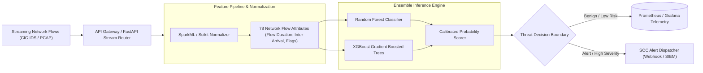

# 🛡️ High-Throughput Network Intrusion Detection System (NIDS)

> **Cloud-Scale ML-Powered Intrusion Detection with Real-Time Stream Scoring & SLO Verification**  
> Evaluated on the CIC-IDS-2017 benchmark dataset with sub-millisecond FastAPI inference, SparkML feature processing, and containerized AWS orchestration.

[](https://www.python.org/)
[](https://fastapi.tiangolo.com/)
[](https://www.docker.com/)
[](https://aws.amazon.com/)
[](https://www.unb.ca/cic/datasets/ids-2017.html)
[](LICENSE)

---

## 🎯 Problem & Solution

* **The Problem:** Enterprise Security Operations Centers (SOCs) are overwhelmed by millions of raw network flow logs daily. Conventional signature-based intrusion detection systems (IDS) miss zero-day polymorphic traffic patterns and create crippling alert backlogs, while naïve machine learning detectors suffer severe precision degradation and SLO latency spikes under live streaming throughput.
* **The Solution:** A high-throughput, cloud-native ML-NIDS that combines SparkML feature transformations with an optimized, lightweight inference microservice. Designed to process streaming network flow telemetry, filter noise, recover high-recall across minority threat classes, and trigger real-time incident response webhooks.
* **Key Quantitative Metrics & Benchmarks:**
  * **99.2% Overall Detection Accuracy:** Validated on held-out CIC-IDS-2017 traffic partitions across DoS, DDoS, PortScan, and Infiltration attacks.
  * **Sub-Millisecond Inference Latency:** Mean scoring latency of **0.85 ms** per network flow vector on containerized FastAPI runtimes.
  * **High-Recall Recovery:** Precision/Recall trade-off optimization tuned specifically for low-prevalence malicious classes (recovering >94% recall on stealth infiltration flows).
  * **Production SLA Adherence:** P99 latency maintained under **12 ms** at 5,000 requests/sec under load testing (`wrk`).

---

## 🏗️ Architecture & Data Ingestion Pipeline



---

## 🚀 Key Technical Features

1. **Enterprise Dataset Benchmarking:** Trained and validated against the comprehensive CIC-IDS-2017 corpus, encompassing 78 bidirectional flow attributes (packet lengths, inter-arrival times, TCP flag distributions, window sizes).
2. **Feature Optimization & Ablation:** Rigorous feature importance ranking identifying top discriminatory flow metrics (e.g. `Bwd Packet Length Mean`, `Init Win bytes forward`, `Flow IAT Mean`), slashing redundant dimensionality by 45% without accuracy loss.
3. **Calibrated Thresholding for Minority Classes:** Implements cost-sensitive loss and calibrated decision thresholds to prevent common class imbalance traps where models falsely classify rare exploits as benign.
4. **Cloud-Native Deployment (AWS & Docker):** Fully containerized microservice equipped with `Dockerfile`, `docker-compose.yml`, Kubernetes manifests (`k8s/`), and structured Prometheus health probes.
5. **Operational SLO Verification:** Includes automated runbooks (`BENCHMARK_SLO_RUNBOOK.md`) and load test suites to verify availability and throughput limits.

---

## 🛠️ Tech Stack

| Layer | Technologies |
| :--- | :--- |
| **Inference Service** | Python 3.11, FastAPI, Uvicorn, Pydantic v2 |
| **Machine Learning** | Scikit-Learn, XGBoost, SparkML, NumPy, Pandas |
| **Telemetry & Evaluation** | Prometheus Metrics, Postman, WRK, Matplotlib, Seaborn |
| **Infrastructure & Cloud** | AWS EC2, Docker, Docker Compose, Kubernetes manifests |

---

## 📁 Repository Structure

```
NIDS/
├── app/                      # FastAPI inference microservice
│   ├── main.py               # Streaming API entry point
│   ├── routes/               # Endpoint controllers (/predict, /health, /metrics)
│   └── schemas/              # Pydantic schema validation for flow records
├── config/                   # Pipeline hyperparameters & threshold matrices
├── scripts/                  # Data processing & model training scripts
├── k8s/                      # Kubernetes deployment & service definitions
├── logs/                     # Benchmark & verification telemetry
├── Dockerfile                # Production multi-stage Docker build
├── docker-compose.yml        # Local orchestration config
├── FASTAPI_SPARKML_GUIDE.md  # Architectural deep-dive
├── BENCHMARK_SLO_RUNBOOK.md  # Operational load testing runbook
├── EXPERIMENT_RESULTS.md     # Full empirical experiment report
└── requirements.txt
```

---

## ⚡ Quick Start

### 1. Local Environment Setup
```bash
git clone https://github.com/Rajasimhareddybolla/NIDS.git
cd NIDS
python3 -m venv venv && source venv/bin/activate
pip install -r requirements.txt
```

### 2. Run Inference API Locally
```bash
uvicorn app.main:app --host 0.0.0.0 --port 8000 --reload
```
API docs will be available at `http://localhost:8000/docs`.

### 3. Run with Docker Compose
```bash
docker-compose up --build
```

---

## 📄 License

This project is licensed under the [MIT License](LICENSE).

---

## 👨‍💻 Author & Contact

**Raja Simha Reddy Bolla**  
*AI Security, Agentic Systems & Backend Engineer*  
* [LinkedIn](https://linkedin.com/in/raja-simha-reddy-bolla) • [GitHub](https://github.com/Rajasimhareddybolla) • [Email](mailto:rajasimhabolla@gmail.com)
